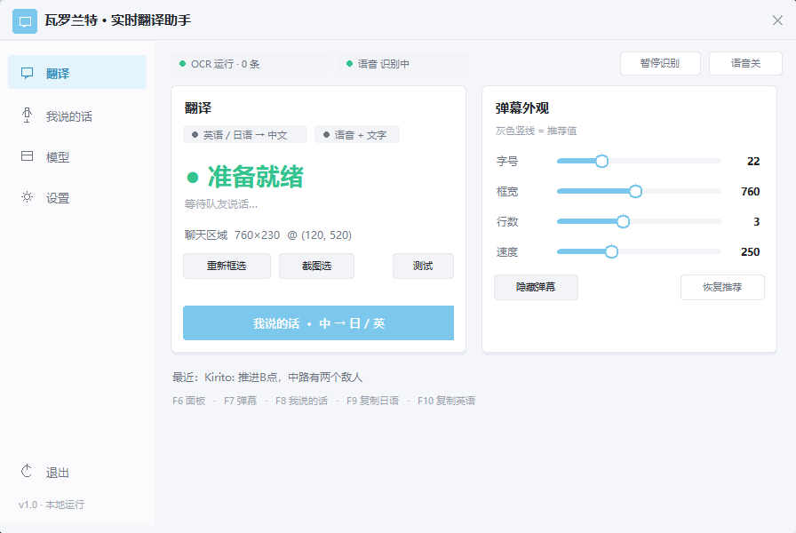
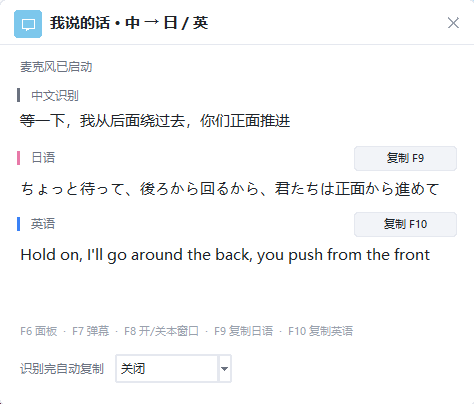
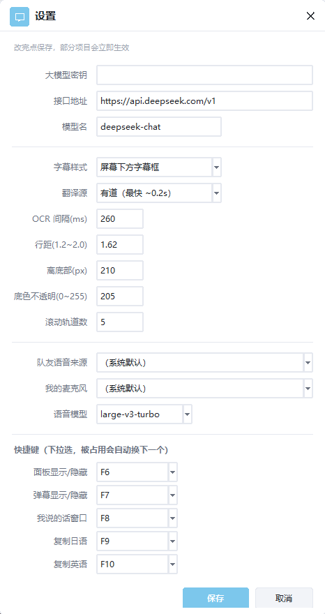
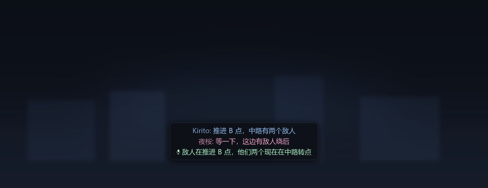

> ⚠️ **暂时提供**：打包好的可用版本，功能稳定但仍在持续调整。
>
> 本工具面向**中文玩家**：
> - **队友英文 / 日文 → 中文**：聊天框 OCR + 队友语音，实时出中文弹幕
> - **你说中文 → 英文 / 日文**：麦克风识别后给出日/英译文，复制到游戏聊天框
>
> 其它语言方向暂不支持。
# 瓦罗兰特 实时翻译弹幕（文字聊天 + 语音）

打国际服时，队友用英语/日语**打字**或**开麦说话**，程序会在屏幕下方弹出中文字幕：

- 💬 聊天文字 → 截屏 OCR 识别 → 翻译
- 🎤 队友语音 → 录系统声音 → Whisper 语音识别 → 翻译
- 都显示在屏幕下方同一个半透明圆角字幕框里（文字白色、语音绿色 + 话筒图标）
- 不读游戏内存、不注入、不碰反作弊

---

## 界面预览

**主面板**（PCL 启动器风格：左侧图标导航 + 卡片内容 + 底部大按钮）



**我说的话**（说中文 → 日文/英文，F9/F10 复制）



**设置**（字幕样式、语音设备、模型、密钥都在这里）



**字幕框**（游戏里实际显示的样子）



---

## 零、安装（有安装包的话）

双击 **瓦罗兰特翻译助手-Setup-1.0.0.exe** → 下一步 → 安装到 `%LOCALAPPDATA%\Programs\ValorantDanmaku`（不需要管理员）。
装完桌面/开始菜单会有快捷方式，**已内置显卡加速库和日语识别包**，不用再跑任何 bat。

- 配置文件 `config.json`、日志、模型都在安装目录里，卸载时日志和缓存会一并删除，`models` 会保留。
- 想搬走已有的聊天区域设置：把旧的 `config.json` 复制到安装目录即可。

## 一、第一次使用'

**桌面双击「瓦罗兰特翻译助手」**（译字图标的那个）即可启动，不会弹黑框。
快捷方式丢了或换了位置，双击项目里的 `创建桌面快捷方式.bat` 重新生成。
需要看日志时用 `启动.bat`（会带一个控制台窗口）。

**1. 启动后会自动弹出框选**

第一次启动屏幕会变暗，用鼠标**拖拽框住游戏里的聊天区域**（队友打字显示的那一块）。
框完立刻生效并**写进 `config.json`**，以后每次启动直接沿用，不用再框（换分辨率/换显示器导致区域越界时会自动让你重框一次）。

**2. 点「测试弹幕」验证**
底部字幕框里应该依次飘出 3 条中英日译文 → 显示链路正常。

**3. 想用语音的话，先双击 `安装语音.bat`**
安装语音识别依赖 + 下载模型（约 600MB，一次性，走 hf-mirror 镜像）。
装完重启程序，面板上会显示「语音：识别中」。

**游戏必须设成「窗口化全屏 / 无边框全屏」**：设置 → 视频 → 通用 → 显示模式 → 窗口化全屏。
> 独占全屏（Fullscreen）下，**任何**第三方覆盖层都画不上去——弹幕框和框选遮罩都会「消失」。
> 如果改完还是看不到，试试桌面上的 **「瓦罗兰特翻译助手(管理员)」** 快捷方式
> （游戏以管理员权限运行时，普通权限的窗口会被压到下面）。

### 游戏是全屏 / 覆盖层不显示？

四个办法，前三个解决"看得见"，第四个解决"听得见"：

1. **改成窗口化全屏（最根本）**：游戏设置 → 视频 → 显示模式 → 窗口化全屏。
   注意：窗口化全屏是**无边框铺满整屏**，和全屏肉眼无差别，帧数也基本一样。
2. **用管理员身份启动**：双击桌面上的「瓦罗兰特翻译助手(管理员)」。
3. **用「截图选（全屏游戏用）」**：主面板聊天区域那一行右边的按钮。
   点一下 → 有 3 秒倒计时 → 这 3 秒里切回游戏 → 程序把当前画面**截下来**，
   然后在桌面上让你在截图里框选，坐标一样映射回游戏。
   （如果截到的是全黑，说明还是独占全屏，只能走第 1 步。）
4. **打开「播报」**：翻译卡片右边那个 `播报：关/开` 按钮。
   打开后每条译文都会用中文语音念出来，**任何显示模式下都能用**——
   弹幕画不上去的时候，你至少能听见队友说了什么。

---

'## 快捷键（游戏里直接按，全局有效）

> **复制到游戏里**：按 `F9/F10`（或备用键）后，直接在游戏聊天框 `Ctrl+V`。
> 剪贴板是直接写进 Windows 的，**不需要先切回面板**，也不依赖窗口焦点。
> 每次复制屏幕下方会闪一条「已复制日语」，看到它就说明复制成功了。

> **只会开一个实例**：程序做了单实例保护——重复双击快捷方式只会把已开的窗口叫到前面，
> 不会再多跑一份（多份会各跑一遍 OCR 和语音，弹幕就会重复）。
'

| 键 | 作用 |
|---|---|
| **F6** | 显示 / 收起控制面板（玩游戏时桌面更干净） |
| **F7** | 显示 / 隐藏**弹幕层**（觉得挡视野随时按一下，再按恢复） |
| **F8 / F11** | 开 / 关「我说的话」窗口 |
| **F9 / Ctrl+Alt+F9** | 复制当前这条的**日语**译文 |
| **F10 / Ctrl+Alt+F10** | 复制当前这条的**英语**译文 |

'
> F8/F9/F10 经常被别的软件（显卡驱动、录屏、启动器）占用，
> 程序会**自动换成可用的键**，面板最下面那行显示的就是当前实际生效的键。
> 每次按键都会在屏幕下方闪一条提示，告诉你按到了没有。

**这些键可以自己改**：设置 → 最下面「快捷键」，五个动作各选一个键（F1~F12 或 Ctrl+Alt+F1~F12），
保存后立即生效，面板底部提示也会跟着变。'

## 二、面板说明

| 控件 | 作用 |
| --- | --- |
| 框选聊天区域 | 重新框选聊天框（换分辨率/换显示器后要重框） |
| 测试弹幕 | 用三条样例检查效果 |
| 暂停识别 | 暂停文字 OCR（语音不受影响） |
| 语音关 / 语音开 | 开关队友语音翻译 |
| 我说的话（中 → 日/英） | 打开「麦克风→中文识别→日文/英文」小窗，用来复制到聊天框 |
| 字号 | 14~44，越小越不挡视野（推荐 22） |
| 框宽 | 360~1200 像素，字幕框最大宽度（推荐 760） |
| 行数 | 1~6，最多同时显示几条（推荐 3） |
| 恢复推荐 | 一键回到 22 / 760 / 3 / 250 |
| 速度 | 只在"全屏滚动"样式下有用（推荐 250） |
| 翻译源 | 必应（默认，国内直连）/ MyMemory / Google / 大模型 |
| 播报：开/关 | 把译文用语音念出来（独占全屏看不到弹幕时靠它） |
| 设置 | 填 DeepSeek 密钥、换语音设备、换识别模型 |
| 样式 | 字幕框 ↔ 全屏滚动 一键切换 |
'| 隐藏弹幕 | 只关显示，识别翻译继续跑 |
| 弹幕顺序 | 旧的在上面，新的往下加；同一句 25 秒内不会重复出现 |'

面板可拖到屏幕角落，不会挡住操作。

---

## 三、字幕框（默认样式）

屏幕下方居中的**圆角半透明气泡**，译文一条条往上叠，每条 7 秒后消失，最多 3 条。
框宽跟着文字自动收缩，不占一大块；新消息淡入，没消息时自动隐藏。

想再调，改 `config.json`：

```json
"danmaku_font_size": 22,     // 字号 14~44（面板滑块）
"box_width_px": 760,         // 框宽 px（面板滑块，360~1200）
"box_max_lines": 3,          // 同时最多几条（面板滑块，1~6）
"box_line_spacing": 1.62,    // 行距（设置里改，1.1~2.2）
"box_bottom_margin": 210,    // 离屏幕底部像素（设置里改）
"box_bg_alpha": 205,         // 底色不透明度 0~255（设置里改）
"box_ttl_s": 7.0,            // 每条停留秒数
"box_width_ratio": 0.34      // 比例宽度（box_width_px=0 时启用）
```

> **想手动精确微调**：面板上拖「字号 / 框宽 / 行数」三个滑块就是大小和长短；
> 行距、距底部、底色透明度在「设置」里，改完点保存立刻生效。

---

## 四、语音翻译（队友开麦）

'### 不会翻译英雄自己的台词

游戏里角色会自言自语（"Watch this!"、"Here comes the pain"），这些声音和语音频道混在一起，
以前会被当成队友说话。现在有两道过滤（设置里可关）：

1. **台词库精确匹配**：只收又长又好认的整句
2. **音量判据**：台词是贴脸播的，比语音频道响得多；又响又短、且不含战术词（点/敌人/包/推…）就丢掉

> 宁可漏一句台词，也不会误删队友的报点——含战术词的句子一律保留。

### 速度：现在一句话大约 0.7 秒出字幕

| 环节 | 之前 | 现在 |
|---|---|---|
| 等说完（VAD 静音判定） | 550ms | **400ms** |
| 语音识别（GPU） | 420ms（small） | **285ms（large-v3-turbo）** |
| 翻译 | 800ms（必应） | **170ms（有道）** |
| **合计** | **~1.8s** | **~0.85s** |

- 识别模型换成 **large-v3-turbo**（比 small 准得多，速度还更快），首次启动要在后台加载约 25 秒；
  显存不够会自动退回 small。
- 翻译源默认 **有道（快）**；想更准可以在「设置 → 翻译源」换成 **必应（准，~0.8s）**。
  机翻常见的错译（插钉子→下包、旋转→转点、B网站→B点、低血量→残血）都由本地词表兜住了。
'

**原理**：录制系统正在播放的声音（WASAPI 环回）→ 能量 VAD 切成一句句 → faster-whisper 识别 → 翻译 → 绿色弹幕。

- 延迟：说完话约 **1.5~3 秒**出字幕（取决于句长和机器性能）
- 语言：英语、日语（也能认出中文，中文会原样显示）
- 过滤：枪声/音乐这类"没有人说话"的声音会被 `no_speech_prob` 和能量阈值挡掉，偶尔漏网会看到奇怪的一行

**想更准，可以这样做：**

1. 瓦罗兰特设置 → 音频 → 把「**语音聊天输出**」单独设到一个扬声器/耳机（和游戏音效分开），
   然后在本程序的「设置」里把**语音来源**选成那个设备 → 只录人声，不录枪声。
2. 或者把游戏音效音量调低一些。
3. 「设置」里把**语音模型**从 `small` 换成 `medium`（更准，但更慢、内存更高）。

### 用显卡加速（可选，N 卡）

程序会**自动检测**：有 NVIDIA 显卡就走 CUDA（fp16），没有就用 CPU（int8），不用手动选。

> 双击 **`安装显卡加速.bat`** → 装 cuBLAS + cuDNN（约 800MB）→ 重启程序，面板显示「语音 识别中·GPU」。

实测（RTX 5070 Ti，一段 7.2 秒语音）：

| | CPU (int8) | GPU (fp16) |
| --- | --- | --- |
| 识别耗时 | ~950 ms | **~420 ms** |
| 说完到出字幕 | ~2.5 秒 | **~1.5 秒** |

显存占用约 1GB、每次推理只跑几百毫秒，**对游戏帧数基本没有影响**。
装了显卡加速但想省电，也可以在「设置」里把语音模型换成 `base`。

> 首次启动会花约 30 秒做 CUDA 预热（在后台跑，面板显示"加载中"），之后就一直是 0.4 秒级。

### 游戏黑话翻译

识别和翻译都针对瓦罗兰特做了处理，不会再把 `B点` 当成"地点"：

- **识别层**：给 Whisper 一段「瓦罗兰特词表」做提示词，B点/A点/绕后/下包 这类词不会听错
- **翻译层**：中文口语先转成英文术语再翻译 —— `B点→B site`、`下包→plant the spike`、
  `架枪→hold the angle`、`残血→low hp`、`经济局→eco round`、`快攻→rush`

效果对比：

```
我说：我要进攻B点，你们从中路绕后
  日语：私はBサイトを攻めます、あなたたちはミッドから回り込んでください
  英语：I will attack the B site, you guys flank from mid
```

### 英雄名也叫得对

中文社区基本不喊官方译名，程序内置了一张 **26 个英雄的别名表**，**双向都认**：
你打中文昵称，它翻成英/日；队友说英/日，它翻回中文。

| 英雄 | 玩家常叫（都认） | 英文 | 日文 |
| --- | --- | --- | --- |
| 捷风 | 捷特 / 风女 / 空姐 | Jett | ジェット |
| 贤者 | 奶妈 / 魏凌萤 / 奶婆 | Sage | セージ |
| 尚勃勒 | 钱包 / 尚伯乐 / 商伯乐 | Chamber | チェンバー |
| 火男 | 不死鸟 / 凤凰 / 火哥 | Phoenix | フェニックス |
| 雷兹 | 炸弹妹 / 炸弹人 / 炮妹 | Raze | レイズ |
| 霓虹 | 闪电 / 电女 / 尼昂 | Neon | ネオン |
| KAY/O | 凯欧 / 机器人 | KAY/O | KAY/O |

> 别把名字认串：
> **火男 = 不死鸟 = Phoenix**（不是尚勃勒）；**炸弹妹 = 雷兹 = Raze**（不是霓虹）。
> 尚勃勒是「钱包」，霓虹是「闪电」，是另外两个英雄。

```
我说：钱包在B点架枪        →  Chamber は Bサイトで角を守る
我说：奶妈赶快给我奶一口     →  セージ、早く私を回復して
队友说：Jett is one shot, push now  →  捷风残血，现在推进
队友说：eco round, flank mid       →  经济局，中路绕后
```

（别名表在 `app/agents.py`，想加自己常说的叫法直接往 `AGENTS` 里加一行就行。）

---

## 五、我说的话（中 → 日/英，复制到聊天框）

想跟日本队友/欧美队友**打字**沟通又不想手打时用这个。

1. 主面板点「**我说的话（中 → 日/英）**」
2. 对着麦克风说中文，例如「等一下，我从后面绕过去」
3. 约 2~3 秒后窗口里出现三行：**中文识别 / 日语 / 英语**
4. 游戏里直接按 **F9 复制日语**、**F10 复制英语**（全局热键，不用切出游戏）
   - **F8** 可以随时开/关这个窗口，不用回去点面板
   - 键位被占用时会自动换成 F11 / Ctrl+Alt+F9，面板底部会显示实际键位
5. 游戏聊天框 `Ctrl+V` 粘贴 → 回车

- 想更省事：窗口里「识别完自动复制」选「自动复制日语」，说完直接 Ctrl+V
- 说的语言默认按**普通话**识别（输出简体）；会说英文的话把 `config.json` 里 `selftalk_language` 改成 `auto`
- 麦克风在「设置 → 麦克风」里选
- 这段只做识别和翻译，**不进弹幕**，也不会把你自己说的话当成队友语音

## 六、日语文字识别（两个方案，任选其一）

Windows 自带 OCR 只有中英文，日文要额外补一个引擎。**优先试方案一，不行就用方案二。**

**方案一：装 Windows 日语语言包（最省 CPU）**

> 双击 **`安装日语识别.bat`** → UAC 点「是」→ 装完**重启电脑** → 重启程序。

语言包只有 3.39MB，但国内很多机器会卡在「安装挂起」（微软的组件下载走不通），重启也不会生效。

**方案二：离线日语引擎 PaddleOCR（更稳，但吃 CPU）**

> 双击 **`安装日语识别-离线.bat`** → 等它下完（约 250MB）→ 重启程序。

原理：复用 Windows OCR 已经切好的行框，只对每一行跑日文识别（4 行约 100~250ms），
只有「Windows 没认出假名、Paddle 认出假名」的行才替换，所以中英文不受影响。

- 程序启动时如果发现系统没有日语包，会自动加载离线引擎（面板日志里能看到）
- 不想用就在 `config.json` 里设 `"ja_fallback": "off"`
- 两个都没装：日文那几行会显示成乱码（英文/中文照常）

---

## 七、模型（语音包 / 语言包）

面板左边点 **「模型」** 就是模型管理窗口，能换、能下、能导入。

### 语音包（队友语音识别）

| 显卡 | 推荐 | 说明 |
|---|---|---|
| RTX 3060 / 2060 / 核显 | `tiny` / `base` | 75~145MB，显存 1GB 就够 |
| RTX 4060 / 3070 | `small` | 484MB，均衡 |
| **RTX 4070 / 5070Ti / 4080** | **`large-v3-turbo`（默认）** | 1.6GB，又准又快 |
| RTX 4090 / 显存 8GB+ | `large-v3` | 3.1GB，最准但最慢 |

每个包的准确大小、显存占用在窗口里都写着，**点「使用」立刻切换**，点「下载」自动下到模型目录。

### 模型放在哪

```
默认：<程序目录>\models\
       └─ models--mobiuslabsgmbh--faster-whisper-large-v3-turbo\
            └─ snapshots\<hash>\   ← model.bin / config.json / tokenizer.json

想放别处：config.json 里改 "asr_model_dir": "D:\\models"
自己已有的模型：模型窗口 →「从文件夹导入语音包…」，直接指向那个文件夹（不复制，省空间）
```

导入的文件夹里必须有 `model.bin` + `config.json`（faster-whisper / CTranslate2 格式），
HuggingFace 上的 `Systran/faster-whisper-*` 系列都符合。

### 手动下载（网络不好时）

```powershell
$env:HF_ENDPOINT = "https://hf-mirror.com"
pip install huggingface_hub
huggingface-cli download mobiuslabsgmbh/faster-whisper-large-v3-turbo `
    --local-dir D:\models\turbo
```
然后把 `D:\models\turbo` 用「从文件夹导入语音包…」导进来即可。
其他模型把仓库名换成 `Systran/faster-whisper-tiny` / `-base` / `-small` / `-medium` / `-large-v3`。

### 语言包（聊天文字 OCR）

| 语言 | 来源 | 位置 |
|---|---|---|
| 英语 / 中文 | Windows 自带 OCR | 系统组件，无需下载 |
| 日语 | PaddleOCR 离线包 | `cache\paddlex\official_models\PP-OCRv5_mobile_rec` |

日语包里没有的话，模型窗口会显示「安装日语包」按钮，点它会跑 `安装日语识别.bat`；
也可以「导入语言包…」指向别的 paddlex 缓存目录（`config.json` 里的 `ocr_model_dir`）。

---

## 八、能做什么 / 注意什么

**能**
- 英文 → 中文、日文 → 中文（术语做了优化：mid=中路、rotate=转点、eco=经济局、rush=快攻…）
- 中文消息原样显示
- 同一条消息只显示一次（多帧确认 + 相似度去重）
- 原文+译文记到 `logs/chat.jsonl`

**注意**
- 只截取**你框选的那一小块**做 OCR；语音是录系统正在播的声音，两者都不读游戏内存
- 聊天框要保持可见（缩小/透明化就截不到）
- 翻译走在线接口，网络差时会先直显原文
- 语音会连游戏音效一起录进去，靠 VAD 和识别置信度过滤，无法 100% 干净

---

## 九、常见问题

**Q：框选后没反应？**
先点「测试弹幕」——有弹幕说明显示正常，问题在识别：确认框的是聊天文字区、让队友发一条消息、看面板"抓帧"数有没有涨。

**Q：语音一直不触发？**
① 面板是否显示「语音：识别中」；② 系统音量/游戏音量是不是被静音了；③ 「设置」里换一个语音来源设备试试。

**Q：字幕每次都不一样/有乱码？**
文字：把框选范围收窄到只剩文字；日语记得装语言包。
语音：换 `medium` 模型，或按第四节把语音输出单独分设备。

**Q：翻译读着别扭？**
必应对短句意译一般。点「设置」填一个 DeepSeek key，再把翻译源切到「大模型」，游戏黑话会自然很多。

**Q：弹幕挡视野？**
面板把字号拉到 16~18，或把 `box_bottom_margin` 调到 160，或点「隐藏弹幕」。

---

## 十、目录结构

```
valorant-danmaku/
├─ 创建桌面快捷方式.bat       生成/修复桌面图标
├─ run.pyw                  桌面快捷方式的入口（无黑框启动）
├─ assets/app.ico           程序图标
├─ 启动.bat                 启动（带控制台，调试用）
├─ 安装语音.bat             安装语音识别（依赖 + 模型）
├─ 安装显卡加速.bat          装 CUDA 库，语音识别快 2 倍（可选）
├─ 安装日语识别.bat          安装 Windows 日文语言包（方案一）
├─ 安装日语识别-离线.bat      安装离线日文引擎 PaddleOCR（方案二）
├─ install.bat              基础依赖
├─ config.json              配置（自动生成，可手改）
├─ app/
│  ├─ main.py               入口：线程调度、事件分发
│  ├─ config.py             配置模型
│  ├─ translator.py         翻译（必应/MyMemory/Google/大模型 + 缓存）
│  ├─ game_terms.py         游戏黑话预处理（B点→B site / 下包→plant the spike）
│  ├─ ocr/                  文字聊天：截图 → Windows OCR → 去重
│  ├─ voice/                语音：环回采集 → VAD → Whisper
│  └─ ui/                   字幕框（Win32 分层窗口）、面板、设置
├─ logs/chat.jsonl          识别+翻译记录
├─ models/                  语音模型
└─ tools/                   自测脚本
```

---

## 十一、隐私

- 截图只在你框选区域内、只在本机处理，**不保存、不上传**
- 语音只录"电脑正在播放的声音"，不碰麦克风
- 只有**识别出来的文字**会发到翻译接口（必应/MyMemory/Google 或你填的大模型）
- 不想留记录：`config.json` 里 `"log_enabled": false`
